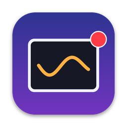

<p align="center"></p>

# iPad Live

Show your iPad's screen on your Mac, live and lag-free, so you can share it in Zoom, Google Meet or FaceTime.

Plug your iPad into your Mac with a cable and open **iPad Live**. A clean window on your Mac then shows exactly what's on your iPad: your drawing in Concepts, your notes, any app. In your meeting, share that window (or your whole Mac screen) instead of sharing the iPad directly.

## Why this is smoother than sharing your iPad in Zoom

When you share an iPad in Zoom, the iPad has to compress its screen and send it over Wi-Fi (AirPlay) or through the Zoom iPad app. That adds delay and drops frames, which is why your strokes show up late and jumpy.

iPad Live uses the cable instead. It's the same path QuickTime Player uses to record an iPad's screen: full resolution and full frame rate, with almost no delay. The picture goes straight from the cable to your Mac's graphics card, with no copying or re-compressing in between. Your meeting app then shares a normal Mac window, which it handles well.

## Requirements

- A Mac with **macOS 14 Sonoma or later**
- A **USB cable** that carries data, from your iPad to your Mac (USB-C to USB-C for newer iPads)
- **Xcode Command Line Tools** to build the app (free, see below)

## Install

1. Install Apple's free developer tools, if you haven't already. Open Terminal and run:

   ```bash
   xcode-select --install
   ```

2. Download this project and build the app:

   ```bash
   git clone https://github.com/calebynhan/ipad-live.git
   ```

   ```bash
   cd ipad-live
   ```

   ```bash
   make install
   ```

   This builds **iPad Live** and puts it in your Applications folder. (`make run` builds it and opens it without installing.)

> **Prefer a ready-made download?** Every push builds the app on GitHub. Open the repo's **Actions** tab, click the latest **Build** run, and download **iPad-Live** at the bottom. The app isn't notarized by Apple, so the first time macOS will refuse to open it. Go to **System Settings → Privacy & Security**, scroll down and click **Open Anyway**. Building it yourself avoids this.

## First run

1. Open **iPad Live**.
2. macOS asks for **Camera** access. Click **Allow**. macOS treats a plugged-in iPad's screen like a camera, which is why it asks. Your Mac's own camera is never turned on.
3. Plug in your iPad and unlock it. If the iPad asks **"Trust This Computer?"**, tap **Trust** and enter your passcode.
4. Your iPad's screen appears in the window within a second or two.

From then on, open the app and plug in the iPad. It connects on its own, and reconnects if you unplug and plug back in.

## Sharing in a meeting

Share the **iPad Live** window. It has no title bar or buttons (they only show when your pointer is over it), so people see just your iPad.

| App | How |
|---|---|
| **Zoom** | **Share Screen** → pick **iPad Live**. Tick **Optimize for video clip** at the bottom-left of the share picker so your drawing looks smooth to others. |
| **Google Meet** | **Share screen** → **Window** → **iPad Live** |
| **FaceTime** | **Share Screen** → **Window**, then click the iPad Live window |

You can also go full screen (double-click the picture) and share your whole screen.

**If the iPad looks smooth on your Mac but choppy to others:** that's the meeting app squeezing its screen share to save bandwidth, and iPad Live can't change that. In Zoom, **Optimize for video clip** makes the biggest difference. You can also raise the limit in Zoom **Settings → Share Screen → Advanced → Limit your screen share to … frames per second**.

## Tips for presenting

- **Keep the iPad awake:** on the iPad, **Settings → Display & Brightness → Auto-Lock → Never**.
- **Hide notifications:** turn on **Do Not Disturb** on the iPad.
- **Hide the iPad's clock and battery:** **View → Hide iPad Status Bar** (⌘B).
- **Keep the window above other apps:** **View → Float on Top** (⌥⌘T).
- **Rotate freely:** turn the iPad and the window reshapes itself to match.

## Controls

| | |
|---|---|
| Move the window | Drag anywhere on the picture |
| Full screen | Double-click the picture, or ⌃⌘F |
| Fit window to the iPad's shape | ⌘0 |
| Low-Latency Mode (on by default) | ⌘L |
| Hide iPad status bar | ⌘B |
| Float on top | ⌥⌘T |
| Reconnect | ⌘R |
| Pick an iPad (if several are plugged in) | **Device** menu |
| Hear the iPad's sound on the Mac | **Device → Play iPad Sound on This Mac** |
| Background colour around the picture | **View → Background** |

iPad Live only *shows* your iPad. You keep drawing and tapping on the iPad itself.

## Troubleshooting

**The window says "Connect Your iPad" but it's plugged in**
- Unlock the iPad, and tap **Trust** if it asks.
- Try another cable. Some cables only charge and don't carry data. If Finder doesn't show your iPad in its sidebar, the cable or port is the problem.
- Unplug and plug back in, or press ⌘R.
- If Finder sees the iPad but iPad Live never does, rebuild once without the hardened runtime to rule it out: `HARDENED_RUNTIME=0 make install`. If that fixes it, the hardened runtime is what was blocking the iPad.

**The picture is black**
- Unlock the iPad. The picture pauses while it's locked or asleep.

**"Camera Access Is Off"**
- Click **Open Privacy Settings** and turn on **iPad Live** under **Camera**. If macOS asks to quit and reopen the app, do it.
- After you rebuild the app, macOS may ask for permission again. That's normal for apps you build yourself.

**My iPad went quiet while connected**
- While it's connected, the iPad may send its sound to the Mac. Turn on **Device → Play iPad Sound on This Mac** to hear it. macOS asks for Microphone permission, because it treats the iPad's sound like a microphone. Your Mac's own microphone is never used.

## About the delay

There's a small delay between the iPad and the Mac, and most of it can't be removed by any app: over USB, the iPad compresses its screen into video and the Mac decompresses it (QuickTime Player has the same delay).

**Low-Latency Mode** (View menu, ⌘L, on by default) cuts what the Mac side adds. Each frame is shown the moment it arrives instead of being scheduled by its timestamp, and if the Mac ever falls behind it skips stale frames rather than queueing them. Turn it off to compare with Apple's standard preview, or if the picture ever misbehaves.

**To compare the two modes,** open a stopwatch with milliseconds on the iPad, put the Mac window next to it, and take a photo of both screens. The difference between the two readings is the delay.

Other things that help:
- Plug the cable straight into the Mac rather than through a hub or dock.
- Turn off Low Power Mode on the iPad and the Mac.

**What your audience sees:** Zoom, Meet and FaceTime add their own delay on top, usually more than this. Since you draw looking at the iPad, the iPad-to-Mac delay mostly matters if you watch the Mac window.

## Experimental: Wi-Fi (off by default)

iPad Live is cable-only out of the box: no Wi-Fi menus, and it doesn't use your network at all. The cable has the least delay and needs nothing installed on the iPad.

There is also an experimental Wi-Fi mode, which uses a small companion app on the iPad, **iPad Live Sender**. It's switched off because installing the iPad app is a hassle:
- **Download:** Xcode needs its iOS support download (about 9 GB) before it can install any app on an iPad.
- **Weekly reinstall:** with a free Apple ID, the iPad app has to be reinstalled from Xcode every 7 days.

To turn it on, run this, then quit and reopen iPad Live:

```bash
defaults write app.ipadlive.mirror wirelessFeature -bool true
```

To turn it back off, run `defaults delete app.ipadlive.mirror wirelessFeature` and quit and reopen the app.

With Wi-Fi on, the cable still wins: whenever an iPad is plugged in, iPad Live uses the cable and pauses Wi-Fi. Unplug it and Wi-Fi takes over. Expect a little more delay than the cable, and more on busy Wi-Fi. A 5 GHz network with the iPad and Mac close to the router works best.

### What you need

- **Xcode** (free, from the Mac App Store; a big download), plus its **iOS** support download (about 9 GB), which Xcode offers when you first choose an iPad. The Command Line Tools alone can't build iPad apps.
- **Your Apple ID**, to install the app on your own iPad. A free Apple ID works, but iPadOS stops opening apps installed that way after **7 days**. Reinstall from Xcode (one click) when that happens. A paid Apple Developer account ($99/year) makes it last a year.
- **XcodeGen**, which creates the Xcode project: `brew install xcodegen`

### Install iPad Live Sender on your iPad

1. Plug your iPad into the Mac and unlock it. On the iPad, turn on **Settings → Privacy & Security → Developer Mode** if iPadOS asks for it later.
2. In the `ipad-live` folder, run:

   ```bash
   make sender
   ```

   This generates the project and opens it in Xcode.
3. In Xcode, click **iPadLiveSender** in the left sidebar. Under **Signing & Capabilities**, choose your Apple ID as the **Team** for both targets: **iPadLiveSender** and **iPadLiveBroadcast**. Add your Apple ID in Xcode → Settings → Accounts if it isn't listed.
4. Pick your iPad as the run destination at the top of the window, then press **Run** (⌘R).
5. The first time, the iPad won't open the app until you trust yourself as a developer: **Settings → General → VPN & Device Management** → your Apple ID → **Trust**.

If Xcode says the bundle identifier isn't available, change `BUNDLE_ID_PREFIX` in `iPadSender/project.yml` to something unique (for example `com.yourname.ipadlive`) and run `make sender` again.

### Pair (once)

1. On the Mac, in iPad Live, choose **Device → Pair iPad Wirelessly…**.
2. On the iPad, open **iPad Live Sender**. When asked, allow it to find devices on your local network. Tap your Mac.
3. Both screens now show a 6-digit code. **Check that they match**, then click **Pair** on the Mac and tap **Pair** on the iPad. If they don't match, cancel: something else on the network is trying to get in the middle.

### Stream

- In iPad Live Sender, tap the **Start Streaming** button, then **Start Broadcast**.
- Or, from any app: open **Control Center**, touch and hold **Screen Recording**, choose **iPad Live**, then **Start Broadcast**.
- To stop, tap the red indicator at the top of the iPad's screen.

The first time it receives a stream, macOS may ask whether iPad Live can find devices on your local network. Click **Allow**. If the firewall asks whether to accept incoming connections, click **Allow** as well.

### If Wi-Fi doesn't connect

- Make sure both are on the same Wi-Fi network, and that **Device → Allow Wi-Fi Streaming** is ticked on the Mac.
- Check **System Settings → Privacy & Security → Local Network** on the Mac and **Settings → Privacy & Security → Local Network** on the iPad. Both apps must be turned on.
- Guest and school networks often block devices from seeing each other. A home network or personal hotspot works.
- Pair again (Device → Pair iPad Wirelessly…) if you chose **Forget Paired iPads**, or reinstalled or updated the iPad app from an older version.

### Security

Streaming is encrypted, and only an iPad you've paired can connect.

- **Pairing** is "compare the codes", like pairing Bluetooth devices. Both screens show a code worked out from a fresh key exchange, and nothing is handed over until you confirm on both. Someone in the middle of the connection would cause the two screens to show different codes. There is no password involved that could be guessed or cracked later.
- **Each iPad gets its own new 256-bit key** every time it pairs. Only that iPad and your Mac know it, and both ends must prove they have it.
- **Every session uses fresh encryption keys** (TLS with ECDHE-PSK only), so recorded traffic can't be decrypted later.
- The pairing listener only runs while the pairing window is open, handles one iPad at a time, and stops as soon as an iPad is paired. A pairing that stalls is dropped: 15 seconds to get to the code, then 2 minutes to confirm. Clicking **Pair** on the Mac only ever applies to the request whose code is on screen.

Without the companion app, macOS also has wireless mirroring built in: on the iPad, open **Control Center → Screen Mirroring** and choose your Mac. It shows full screen rather than in the iPad Live window, with more delay.

## How it works (for the curious)

- `ScreenCaptureDevices.swift` turns on CoreMediaIO's `kCMIOHardwarePropertyAllowScreenCaptureDevices`. Every app has this off by default. Once it's on, connected iPads and iPhones appear to AVFoundation as external "muxed" (video + audio) capture devices.
- `MirrorSession.swift` watches for those devices, opens the iPad in an `AVCaptureSession` on a background queue, and handles unplugging, errors and rotation.
- `FrameSink.swift` is Low-Latency Mode: an `AVCaptureVideoDataOutput` (dropping late frames) feeds an `AVSampleBufferDisplayLayer`, and every frame is marked `kCMSampleAttachmentKey_DisplayImmediately` so it's shown on arrival instead of at its timestamp.
- `MirrorView.swift` holds the picture: Low-Latency Mode's display layer, or Apple's `AVCaptureVideoPreviewLayer` when the mode is off. A clipping layer trims the status bar.
- `MirrorWindowController.swift` is the chrome-free window: it reshapes on rotation, hides its buttons when the pointer leaves, and hides the pointer when it rests over the picture.
- `Sources/iPadLiveCore` holds the layout math, with unit tests (`make test`, needs full Xcode).
- **Wi-Fi (experimental, off by default):** `Sources/LiveLink` is shared by the Mac app and the iPad app. It holds the message format, numeric-comparison pairing (`PairingCrypto.swift`: X25519 with a commitment, then a confirmed code on both screens), per-iPad 256-bit stream keys used as TLS ECDHE-PSK keys, the low-latency H.264 encoder, and the network code. The iPad's broadcast extension (`iPadSender/Broadcast`) encodes only the newest screen frame and skips frames rather than queueing them. The Mac's `WirelessController` hands received frames to the same instant-display layer as Low-Latency Mode. The tests (`Tests/LiveLinkTests`) pair, stream and decode real video over a loopback connection. They also check that a man in the middle gets mismatched codes, that nothing is handed over until both sides confirm, and that each iPad's key is separate.

## Security

- **Only what it needs:** iPad Live only opens plugged-in iPads and iPhones. It never turns on your Mac's own camera or microphone, and runs no other programs. It makes no network connections unless you turn on the experimental Wi-Fi feature. Even then it only accepts your paired iPad, and everything is encrypted (see [Wi-Fi → Security](#security)).
- **Hardened runtime:** the app is signed with Apple's hardened runtime, which stops other software from injecting code into it and borrowing its camera permission. Its entitlements (`Resources/iPadLive.entitlements`) allow exactly two things: camera (the iPad's screen) and audio input (the iPad's sound).
- **Sharing the app with others:** build with your Developer ID so it can be notarized by Apple: `SIGN_IDENTITY="Developer ID Application: Your Name (TEAMID)" make app`
- **CI:** the GitHub workflow has read-only access, pins each action to an exact commit, and checks that every build is signed with the hardened runtime and the two entitlements above.

## Project layout

```
Package.swift                 Swift package (no Xcode project needed)
Sources/iPadLive/             The Mac app
Sources/iPadLiveCore/         Layout math (unit tested)
Tests/iPadLiveCoreTests/      Tests for the layout math
Resources/Info.plist          App info and permission messages
Resources/AppIcon.icns        App icon
Resources/iPadLive.entitlements  What the hardened runtime allows (camera + audio input)
Sources/LiveLink/             Experimental Wi-Fi streaming protocol, shared by the Mac and iPad apps
iPadSender/                   Experimental iPad app, iPad Live Sender (project.yml → make sender)
scripts/build-app.sh          Builds and signs build/iPad Live.app
Makefile                      make app | run | install | test | clean
```
